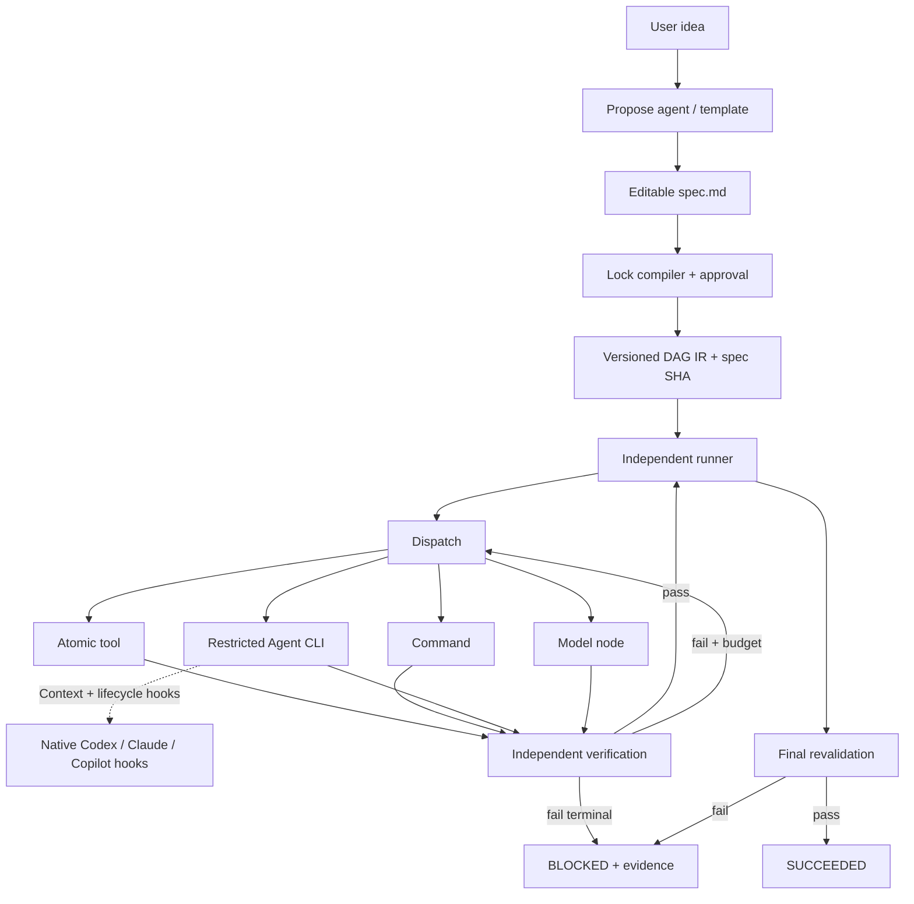

# SpecFlow architecture and design decisions

## 0. Product thesis

The unit of control is **not the LLM turn**: it is a verifiable, persisted **node transition**. One agent can execute several model/tool turns inside a node, but it cannot certify that node as complete. The runner commits the node only if checks pass and the promised artifacts exist. Graph completion requires revalidation of **all invariant-bearing nodes**, plus independent requirement acceptance.

A correct claim is `COMPLETED => Verified(contract, workspace at completion)`. An incorrect claim is `Proposed => Agent eventually succeeds`. No framework can promise the latter for inconsistent, unknowable, or physically impossible specifications. A failed loop with a useful diagnosis is a first-class result.

## 1. Components and trust boundaries



Control plane (SpecFlow) includes: stable IR, locks, scheduler, check dispatch, state transitions, evidence, run log, retry decisions, hook glue. Data plane includes CLI provider and native tools. They are deliberately decoupled so providers can be swapped.

**Authority order**: validated user contract > locked runner state > node profile / implementation > untrusted repository/tool context. Native hooks help make this authority visible to the model; actual enforcement is the host permissions + runner checks. No amount of quoted system-prompt text creates a security boundary.

## 2. Two-level formalization

### Natural-language Spec (human contract)

- Goal and boundaries
- `R1...Rn` stable requirement IDs
- `Acceptance` with independently executable checks
- Constraints (non-functional, prohibited changes, compatibility)

Spec should describe observable behavior and negative constraints, **not** constrain every internal thought. Anti-pattern: "Think for ten turns and always edit file X". Good: "Command X accepts invalid input and exits code 2 without writing output".

### Locked IR (machine contract)

The Lock phase should:

1. Parse all requirement IDs and acceptance IDs; reject untestable omissions.
2. Have planner propose only a candidate implementation graph.
3. Expand nested `flow` nodes into stable namespaced IDs.
4. Ensure all references resolve and DAG is acyclic.
5. Attach a topological terminal acceptance node to all sinks.
6. Freeze `spec_hash` and compiled graph. Approval is explicit.

Crucially, automatic spec-to-DAG translation is a planning problem, not a trustworthy deterministic parser. A planner can decompose work but cannot silently weaken user acceptance. The runner injects the acceptance checks **after** planner output, and no graph-generated "success" text is treated as evidence.

Future lock should also emit trace matrix `requirement -> acceptance test -> producer nodes -> artifacts` and a separate `completeness` / `verifiability` report. A requirement with no observable oracle must be flagged for human approval or independent external verification rather than assigned a fake check.

## 3. Node contract and upgrade path

Long-term stable conceptual contract:

```yaml
id: build-api
kind: task
implementation:
  kind: agent             # later: atomic / command / model / external
  ref: builder@1
inputs:
  - spec:R1
outputs:
  - artifact:src/api.py
requires:
  - prepare-env
checks:
  - run:pytest -q tests/test_api.py
policy:
  filesystem: workspace-write
  network: disabled
  tools: [read, edit, test]
  time_budget_s: 900
  max_retries: 2
  isolate_context: true
```

The above is a **future conceptual schema**, not fully supported v0.1 JSON. It shows why implementation should not be hardwired to graph semantics. A `prompt/model` implementation can be upgraded to an atomic tool if its input/output schema and verifier remain compatible. With versioned `op` references (`text.write@1`), the system can keep old runs reproducible.

Recommended profiles:

| Profile | Effect | Expected permission | Result |
|---|---|---|---|
| `planner` | Produce proposal/graph | Read-only | Candidate plan |
| `builder` | Change workspace | Workspace write | Files/diff |
| `reviewer` | Independent critique | Read-only | Issues/evidence |
| `investigator` (later) | Observe root cause | Read-only + diagnostics | Failure classification |
| `approver` (later) | Human decision | No model decision | Approval record |

Strong profiles mean actual restrictions on available tools, network, filesystem, and budget. Prompt text alone is a **soft policy**. Isolation needs a container/worktree/backend sandbox and must be declared per adapter's actual capabilities. For assistant-only steps, use fresh subprocess context; `sf` currently uses a new CLI process for each agent node. It does not guarantee provider-native transcript isolation.

## 4. DAG versus retry loops

DAG = static prerequisite relation. Retry = bounded local state transition attached to a node. Do **not** encode `retry -> build` as a cyclic graph edge. If more complex loops become necessary, compile a bounded subflow with a repeat policy, retain a compact attempt history, and expose termination conditions explicitly.

Some work cannot be decomposed into deterministic tools from the outset; that is expected. For such nodes, run an `agent` implementation under a narrow profile, with narrow scope and concrete output checks, then replace that implementation later. The same DAG edges and acceptance invariants should survive the migration.

Dynamic plans are a separate feature: produce a new candidate DAG from the current evidence, diff it, obtain approval if contract/permissions changed, then lock a **new graph revision**. Never let an executing node silently rewrite its own acceptance contract.

## 5. Verification strengths

Four evidence tiers, ordered by confidence (not equivalence):

1. **Deterministic oracle:** unit tests, exact schema, compilation, exit status, equality/property tests.
2. **Independent environment evidence:** integration/E2E, actual deployment state, external observations.
3. **Independent model critique:** a separate review agent with explicit evidence and no workspace write access; useful but fallible.
4. **Self-attestation:** the same agent's final message, useful as a hint, never a pass condition.

Risks: an executable `file:` check is shallow; `file` existence can be meaningless for semantic requirements. Plan to ship an Acceptance Quality Linter that classifies weak tests and asks for stronger property tests. A Green DAG with weak oracles is *not* a proven correct implementation.

The runner re-evaluates node invariants at final commit so a downstream stage that destroys an earlier valid invariant cannot leave a stale green status. For external effects, checks must query the external state, not just local manifests. Testing the test checks via deliberate faults (mutation testing) is a valuable future validation technique.

## 6. Hooks and prompt/context injection

Native hooks differ:

- Codex: Hook layers have trust-review and precedence rules; `Stop` may request continuation, but can be skipped or superseded. `SessionStart` adds context.
- Claude Code: `Stop` can block and return a reason; `stop_hook_active` helps prevent infinite feedback. Richer per-tool permissions are possible through `PreToolUse`.
- Copilot CLI: `agentStop` can force continuation; documented runaway guard stops after eight consecutive continuations. Prompt hooks have mode restrictions (not all cloud/non-interactive flows fire them).

V0.1 injects a minimal profile + full locked Spec into managed CLI calls, and optionally adds `SessionStart`/`Stop` callbacks. It intentionally does not pretend that three platforms' tool permission systems are interoperable. Full tool gate adapters need protocol conformance tests by version. `PreToolUse` should not use unsafe shell-regex matching as the only security protection; use native structured tool names/inputs, plus runtime isolation for writes.

Two notions of "prompt injection" must not be confused:

- **Legitimate harness context injection:** scoped role, spec, active node, output schema, checks, failure context, injected by a trusted runner.
- **Adversarial prompt injection:** malicious instructions embedded inside source files, logs, webpages, issue bodies, etc. These are lower-trust task data and cannot override the graph or policies.

## 7. State and failure semantics

Node: `PENDING -> RUNNING -> SUCCEEDED | FAILED`. Run: `RUNNING -> SUCCEEDED | BLOCKED`. `BLOCKED` is a durable, diagnosable state, not a green finish. A crash can leave node RUNNING; resume must require explicit operator acknowledgment, because commands can have partially completed side effects.

Suggested later refinements:

- `WAITING_APPROVAL`, `CANCELLED`, `SKIPPED` and more precise failure categories (`TIMEOUT`, `VERIFIER_FAILURE`, `AGENT_ERROR`), but don't proliferate states without operational need.
- Explicit idempotency keys for external APIs and execution attempt IDs.
- Run cancellation, environment fingerprints, commit references, sensitive log redaction.
- Checkpoint append-only states or SQLite WAL if actual concurrency/scale requires it.

## 8. Built-in atomic strategy

Do not start with hundreds of prompts wrapped as "atomic" implementations. Promote a node to the shared registry only when it has:

- Stable input/output contract
- Deterministic or explicitly stochastic behavior
- Version and tests
- Failure semantics and idempotency guidance
- Reusable value across at least two flows

Proposed library layers:

- `fs.*` text/json/read/copy/move/patch/exists/hash
- `process.*` exit0/stdout/timeout/kill-tree
- `git.*` status/diff/checkpoint/worktree/change-scope
- `quality.*` lint/typecheck/unit/e2e/report
- `artifacts.*` schema/manifest/provenance/checksum
- `agent.*` builder/reviewer/critic/fix
- `flow.*` implement-test-review, bug-triage, upgrade-impl, migration, document-verify

Start with ~10 high-reuse tools and 3 composite flows in v0.2; refuse gratuitous novelty. Providers' existing tools are often better than duplicates.

## 9. Priority roadmap

**v0.1 proof (current):** spec contract, lock, hierarchy, deterministic DAG, multiple executors, native hooks bridge, final verification, recovery, tests.

**v0.2 harden semantics:** trace matrix, per-node inputs/outputs/artifact provenance, JSON Schema, orphan-check linter, flow parameter types, `sf explain`, node check catalog, full adapter smoke tests, configurable budgets.

**v0.3 strong profiles:** provider-specific tool allowlists, capability matrix, optional sandbox/worktree isolation, write scopes, log sanitization, explicit permission approvals, deterministic tool gates and PreToolUse hook parity tests.

**v0.4 reusable flows:** registry/install/catalog/version pinning, implement→test→review, debug→repro→patch→regression, code migration and docs verification; upgrade agent node to tool node without breaking IO contracts.

**v0.5 only if adoption warrants it:** graph parallelism, remote executor, multi-run concurrency, dynamic subgraph locks, TUI/web inspector, cost/resource accounting, shared artifact store.

## 10. Non-goals and naming

Avoid at the start: own model router, RAG framework, Graph DB, event bus, Kubernetes controller, multi-tenant RBAC, general workflow DSL, unsafe "run until success" loops, and silent self-approval.

Naming conflict: SpecFlow is a well-established (now EOL) .NET BDD product; separate projects already use `specflow` for agent protocols and harnesses. In addition, `sf` is commonly used by Salesforce's CLI. Internal development may retain SpecFlow/`sf`, but public branding, PyPI/npm package names and executable command conflicts need explicit clearance.

## References as of 2026-10-27

- Codex hooks: https://learn.chatgpt.com/docs/hooks
- Codex exec: https://learn.chatgpt.com/docs/non-interactive-mode
- Claude hooks: https://code.claude.com/docs/en/hooks
- Claude CLI: https://docs.anthropic.com/en/docs/claude-code/cli-usage
- Copilot hooks: https://docs.github.com/en/copilot/reference/hooks-reference
- Copilot programmatic CLI: https://docs.github.com/en/copilot/reference/copilot-cli-reference/cli-programmatic-reference
- OpenSpec workflow (contrast): https://openspec.dev/docs/schemas/spec-driven
- Reqnroll/legacy SpecFlow: https://docs.reqnroll.net/latest/help/faq.html
